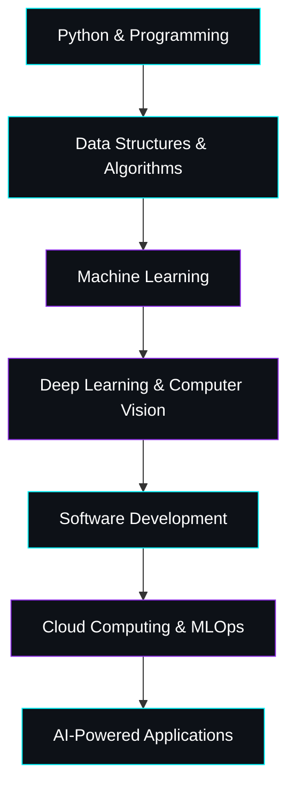

 <!-- Rajath Mohare | Cyberpunk GitHub Profile -->

<!-- ================= HERO SECTION ================= -->

<p align="center">
  
</p>

<h1 align="center">⚡ RAJATH MOHARE</h1>

<h3 align="center">
  AI/ML Engineer | Software Developer | Technology Enthusiast
</h3>

<p align="center">
  
</p>

<p align="center">
  <a href="https://github.com/rajath17">
    
  </a>
  <a href="https://www.linkedin.com/in/rajath-mohare-a1487b275">
    
  </a>
  <a href="mailto:moharerajath@gmail.com">
    
  </a>
</p>

<p align="center">
  
  
</p>

---

<!-- ================= ABOUT ME ================= -->

<h2 align="center">⌁ ABOUT ME</h2>

```yaml
USER: Rajath Mohare

ROLE: AI/ML Engineer | Software Developer

EDUCATION:
  Degree: B.E. Computer Science & Engineering
  Specialization: Artificial Intelligence & Machine Learning
  Graduation: 2026

INTERESTS:
  - Artificial Intelligence
  - Machine Learning
  - Computer Vision
  - Software Development
  - Cloud Computing

MISSION:
  Build intelligent, scalable and impactful technology.

CURRENT_STATUS: Always Learning | Always Building
```

I'm a Computer Science graduate specializing in Artificial Intelligence and Machine Learning. I enjoy building practical applications that combine AI technologies, software engineering and automation.

I focus on writing better code, solving real-world problems and continuously exploring emerging technologies.

---

<!-- ================= DEVELOPER TERMINAL ================= -->

<h2 align="center">⌘ DEVELOPER TERMINAL</h2>

```python
class RajathMohare:

    def __init__(self):
        self.name = "Rajath Mohare"
        self.role = "AI/ML Engineer & Developer"

        self.languages = [
            "Python",
            "Java",
            "C++"
        ]

        self.interests = [
            "Artificial Intelligence",
            "Machine Learning",
            "Computer Vision",
            "Software Development",
            "Cloud Computing"
        ]

        self.mindset = "Learn | Build | Improve"

    def mission(self):
        return "Building technology that makes a difference."


developer = RajathMohare()
print(developer.mission())
```

---

<!-- ================= PROJECTS ================= -->

<h2 align="center">🚀 FEATURED PROJECTS</h2>

<h3>🚗 01. Secure Multi-Agent V2V Communication Framework</h3>

**Autonomous Driving | MetaDrive | Python**

A simulation framework for secure communication between multiple autonomous vehicles.

```diff
+ Multi-Agent Autonomous Driving Simulation
+ MetaDrive Simulator
+ AES-Based Data Encryption
+ UDP Vehicle-to-Vehicle Communication
+ Hybrid A* Path Planning
+ Intelligent Driver Model (IDM)
```

**Focus:** Secure communication, autonomous systems and vehicle coordination.

<h3>🛒 02. AI-Powered Smart Shopping Basket</h3>

**Computer Vision | YOLO | OpenCV**

An intelligent shopping solution using computer vision to detect products and automate shopping operations.

```diff
+ YOLO Object Detection
+ OpenCV Integration
+ Automated Billing
+ QR Payment System
+ Smart Retail Automation
```

**Focus:** Real-time object detection and retail automation.

<h3>🎥 03. AI-Based Proctoring System</h3>

**Python | Computer Vision | AI**

An AI-powered application designed to support online examination monitoring.

```diff
+ Face Monitoring
+ Activity Detection
+ Online Exam Security
+ Automated Monitoring
```

**Focus:** AI-driven examination monitoring and automation.

<h3>🌾 04. RaithaVarta – Smart Farming Assistant</h3>

**Android | Kotlin | Firebase**

A farmer-focused mobile application providing agricultural information and assistance.

```diff
+ Crop Information
+ Weather API Integration
+ Government Schemes
+ English & Kannada Support
+ Firebase Integration
```

**Focus:** Using technology to make agricultural information accessible.

<p align="center">
  <a href="https://github.com/rajath17?tab=repositories">
    
  </a>
</p>

---

<!-- ================= TECH STACK ================= -->

<h2 align="center">⚙ TECHNOLOGY ARSENAL</h2>

<h3 align="center">Programming Languages</h3>

<p align="center">
  
</p>

<h3 align="center">AI / Machine Learning</h3>

<p align="center">
  
</p>

<h3 align="center">Development & Tools</h3>

<p align="center">
  
</p>

<h3 align="center">Libraries & Frameworks</h3>

<p align="center">

  
  
  
  
  

</p>

---

<!-- ================= GITHUB ANALYTICS ================= -->

<h2 align="center">📊 GITHUB ANALYTICS</h2>

<p align="center">
  
  
</p>

---

<h2 align="center">🔥 CONTRIBUTION STREAK</h2>

<p align="center">
  
</p>

---

<!-- ================= ACHIEVEMENTS ================= -->

<h2 align="center">🏆 ACHIEVEMENT WALL</h2>

- 🎓 B.E. Computer Science & Engineering (AI & ML), 2026.
- 🚗 Developed a secure multi-agent autonomous driving simulation.
- 🤖 Built AI and computer vision applications.
- 📱 Completed Android App Development internship.
- ☁️ Exploring Cloud Computing and MLOps.
- 💻 Building projects across AI and software development.

---

<!-- ================= LEARNING ROADMAP ================= -->

<h2 align="center">🧠 LEARNING ROADMAP</h2>



---

<!-- ================= CONTRIBUTION SNAKE ================= -->

<h2 align="center">🐍 CONTRIBUTION SNAKE</h2>

<p align="center">
  
</p>

---

<!-- ================= CONNECT ================= -->

<h2 align="center">🌐 CONNECT WITH ME</h2>

<p align="center">
  <a href="https://github.com/rajath17">
    
  </a>
  <a href="https://www.linkedin.com/in/rajath-mohare-a1487b275">
    
  </a>
  <a href="mailto:moharerajath@gmail.com">
    
  </a>
</p>

---

<p align="center">
  
</p>

<h3 align="center">⚡ BUILDING THE FUTURE, ONE PROJECT AT A TIME.</h3>

<p align="center">
  <i>Code is the tool. Innovation is the mission.</i>
</p>

<!-- END OF README -->
